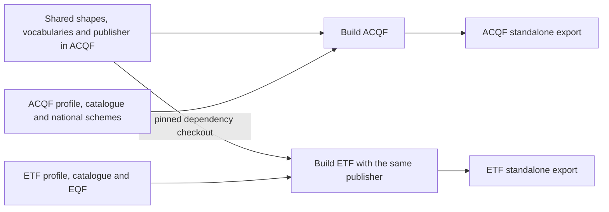

# Public-repository architecture

ACQF is the source of the shared QCP model and publication tools. ETF pins one
reviewed ACQF commit in `publication/acqf.json` and checks it out under ignored
`build/acqf/`. This is an ordinary dependency checkout, with no Git submodule.
Each repository serves its own complete validation export.

| Responsibility | ACQF public repo | ETF public repo |
| --- | --- | --- |
| Shared structure and constraints | `docs/model/common/exchange-model.ttl` | Uses the pinned common file |
| Shared controlled vocabularies | Files listed in `publication/common-vocabularies.json` | Uses the same pinned files |
| Product policy | `docs/model/acqf-profile.ttl` | `docs/model/etf-profile.ttl` |
| Framework catalogue and levels | ACQF catalogue and national schemes | ETF catalogue and full official EQF snapshot |
| Reviewed local inputs | `publication/validation.json` | `publication/validation.json` |
| Publisher, queries and test runner | `publication/` | Thin wrappers invoke `build/acqf/publication/` |
| Product test expectations | `publication/tests/contract.json`, `cross-level.ttl`, `level-expected.tsv` | Same filenames, with ETF expectations |
| Jena version and checksum | `publication/jena.sha512` | Uses the same pin |
| CI implementation | `.github/actions/validate/action.yml` | Uses the pinned local composite action |
| Public standalone artifact | `docs/model/exchange-model.ttl` | `docs/model/exchange-model.ttl` |



## Run locally

Install Java 21+, Bash, jq and GNU coreutils. ACQF's existing commands remain supported:

```bash
./gradlew buildValidation
./gradlew check
```

These tasks install the pinned CLI and delegate to the shared publisher. They do
not compile an RDF application. The direct commands also work from either product's root:

```bash
bash publication/setup-jena.sh
export PATH="$PWD/build/tools/apache-jena-6.2.0/bin:$PATH"
bash publication/publish.sh build
bash publication/publish.sh check
```

Skip setup if the pinned Apache Jena CLI is already on PATH and ETF's dependency
cache is already resolved (or `ACQF_ROOT` is set). Setup downloads the official
distribution and verifies `jena.sha512`. Its archive filename is the
single executable version pin; the installer, publisher and CI use that file.
Build and check use reviewed local inputs, with no application compilation. ETF does not require Gradle.

## What the publisher does

1. Read the common shapes, product profile and explicitly listed vocabulary files.
   Each input gets its own named graph, preserving source boundaries and RDF bases.
2. Let Jena discover `skos:ConceptScheme` IRIs in those files. Configurations list
   paths, not copies of the IRIs already maintained in the RDF. A scheme defined in
   more than one input is rejected rather than silently overridden.
3. Use SPARQL to resolve `controlledVocabulary` bindings and catalogue members'
   `dct:relation` links. Reject invalid profile statements, missing/empty schemes,
   ambiguous catalogue entries, non-IRI members and conflicting `sh:in` constraints.
4. Select distinct members in IRI order. A small awk grouping step emits Turtle
   collections; Jena combines those lists with the structural shapes and profile.
   Resolved binding annotations become `sh:in`; prefix constraints remain intact.
5. Parse the completed shapes, then replace the output by a rename staged in its
   destination directory. Failed builds leave the existing published file intact.

`check` rebuilds temporarily, compares RDF graphs including blank nodes, and runs
shared SHACL fixtures using product-owned expectations. The shared runner contains
no ETF/ACQF branching. It covers all accepted levels, missing/multiple/invalid/mixed
values, diagnostics and duplicate notation. ACQF additionally pins its reviewed
historical standalone export through its test contract. Isolated fixtures omit
`owl:imports` to keep tests offline; the published graph retains its original imports.

Each GitHub workflow checks out its repository and calls the shared local composite
action. The action sets up Java, caches the checksum-pinned Jena distribution and
calls the same local `check` command. CI does not edit, commit or deploy documents.

## Editing and releasing

- Edit shared rules and tooling in ACQF. ETF consumes them through its revision pin.
- Edit each product's policy and vocabulary snapshots in that product's repository.
  Adding a framework requires its catalogue entry, vocabulary file and input-list
  entry. Update the product's test expectations when the intended contract changes.
- Run build/check and commit generated exports with the source changes.
- Publish the ACQF commit first, then update the revision in ETF's
  `publication/acqf.json`, run `bash publication/acqf.sh fetch`, rebuild/check ETF,
  and commit the lock and any resulting export change. A moving ACQF branch or
  changed public website cannot silently change ETF's pinned build.
- For joint local development, set `ACQF_ROOT=/path/to/acqf-checkout` in ETF. This
  explicit override uses that working tree, including uncommitted changes, instead
  of the revision pin. Normal builds use the pinned cache and never fetch.
  Initial setup or an explicit `acqf.sh fetch` resolves the dependency with Git.

Vocabulary refresh automation is deferred. Keep one reviewed snapshot per input;
source provenance for the EQF snapshot is documented in ETF. The frozen shared
`publication/isced-f.jsonld` comes from QCP commit
`c79c70c98078f5857793ec19cc6dbff94abb0f9c`, path
`backend/src/main/resources/concept-schemes/http___data.europa.eu_snb_isced-f_25831c2`.
It is ISCED-F, not the separate published ISCED-2011 scheme.

## Intentional overlap and compatibility

The common source graph and the two complete exports overlap by design. The exports
are generated delivery artifacts, not independently maintained copies. Keep existing
shape and vocabulary IRIs, including ACQF namespace IRIs used by the shared model.
ETF does not copy shared contexts, examples, documentation or vocabulary documents
into its own public `docs/` directory. Applications consume the complete generated
SHACL graph without publisher-specific preprocessing. QCP's packaged vocabulary
lookups are a separate consumer; update them when accepted membership changes.

The older South Africa documents `docs/model/za-qf-levels` and
`docs/model/za-nqf-levels` describe corresponding levels with different published
IRIs. Only `za-nqf-levels` is an input to the current catalogue/build. The older
publication is retained for compatibility; removing or redirecting it requires an
explicit IRI migration, not file deduplication.
