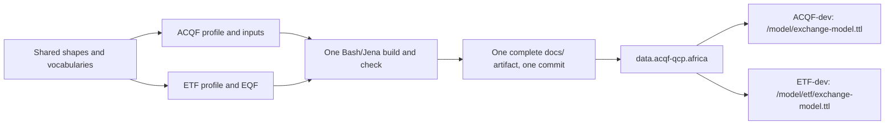

# One public data site, two product contracts

The source of truth is `cognizone/acqf-qpc-public`. It builds the ACQF and ETF
validation contracts together and serves both from **https://data.acqf-qcp.africa/**.
The ETF public repository is retired on `dev2`; no submodule, dependency checkout,
artifact download or second publisher is needed.

| Layer | Maintained files |
| --- | --- |
| Shared structure | `docs/model/common/exchange-model.ttl` |
| Shared vocabulary inputs | `publication/common-vocabularies.json` and its listed files |
| ACQF policy and inputs | `docs/model/acqf-profile.ttl`, existing catalogue/national vocabularies, `publication/products/acqf.json` |
| ETF policy and inputs | `docs/model/etf/profile.ttl`, `docs/model/etf/internal/virtualspace-nqfs`, full `docs/model/etf/eqf-nqf-levels`, `publication/products/etf.json` |
| Shared implementation | `publication/publish.sh`, `queries/`, `tests/check.sh` and shared fixtures |
| Product expectations | `publication/tests/acqf/` and `publication/tests/etf/` |
| CLI dependency | One official Jena archive/version/checksum in `publication/jena.sha512` |
| Complete site | One `docs/` tree, checked and uploaded as one preview artifact |



The diagram describes the intended rollout. `dev2` currently produces a preview
artifact only; it does not publish the website or change application deployments.
See [deployment coordination](DEPLOYMENT.md) before promoting it.

## Build and check

Install Java 21+, Bash, jq and GNU coreutils. Existing commands remain available
and now cover **both** product contracts:

```bash
./gradlew buildValidation
./gradlew check
```

Gradle is a thin command adapter. The direct CLI interface is:

```bash
bash publication/setup-jena.sh
export PATH="$PWD/build/tools/apache-jena-6.2.0/bin:$PATH"
bash publication/publish.sh build          # both products
bash publication/publish.sh check          # both products
bash publication/publish.sh check etf      # one product while editing
```

Setup downloads the official Jena distribution and verifies its pinned SHA-512.
Skip setup if that CLI is already on PATH. Build/check use reviewed local inputs
and do not fetch imports or vocabularies. There is no application compilation.

Each product configuration declares its profile, vocabulary input paths, output
path and expectation directory. The publisher reads shared plus product-specific
inputs into separate named graphs. Jena discovers scheme IRIs from RDF; the input
lists do not repeat them. Duplicate scheme definitions, invalid profile statements,
missing/empty membership, ambiguous catalogue links and non-IRI members fail.

SPARQL resolves direct bindings and catalogue members' `dct:relation` links. Distinct
members are ordered by IRI; a small awk grouping step emits Turtle collections.
Jena merges them with the common shapes and product profile, replacing resolved
binding annotations with `sh:in`. Existing prefix constraints remain intact. Each
output is parsed and replaced by an atomic rename only after successful assembly.

`check` reconstructs each graph temporarily, compares it with the committed export
including blank nodes, and runs shared SHACL fixtures with product-owned expectations.
It covers all 161 ACQF levels and eight EQF levels, missing/multiple/invalid/mixed
values, diagnostics and duplicate notation. The ACQF historical contract remains
pinned in its test data. Isolated fixtures omit `owl:imports` to keep tests offline;
the public graph retains its original imports.

## Public paths and identity

The ACQF endpoint stays `/model/exchange-model.ttl`, with the same graph and existing
model/vocabulary IRIs. ETF has its own complete endpoint at
`/model/etf/exchange-model.ttl`. Both are standalone validation contracts; consumers
select one and do not assemble profiles at startup.

The ETF catalogue and EQF snapshot are served under `/model/etf/`. Their original
scheme/member IRIs are preserved, including the existing ETF catalogue namespace
and official EU EQF IRIs. A graph's download URL and its resource identifiers have
different roles; moving its published file does not rename its resources.

Existing ACQF contexts, examples, documentation, national schemes and URLs are kept.
The website index adds ETF links. The common source and two generated complete
exports overlap intentionally; only the sources are maintained independently.
The older South Africa `za-qf-levels` publication is retained for its existing IRIs;
only `za-nqf-levels` feeds the current ACQF build.

## CI and release boundary

The `dev2` workflow installs the pinned CLI, runs the shared Bash check for both products,
then uploads the **whole** `docs/` directory as `public-data-site-<commit SHA>`.
Failure in either product prevents the artifact upload. There is no Pages deployment
job, repository dispatch, cross-repository fetch or app-deployment trigger.

A future website release must promote this whole validated tree from one reviewed
commit through the existing website publication process. Do not publish ACQF and
ETF files from independently selected revisions. Keep the existing public hostname.
Application deployment is a separate step: coordinate shape URLs and packaged lookup
membership using [DEPLOYMENT.md](DEPLOYMENT.md).

## Snapshot provenance

Vocabulary refresh automation is deferred. Keep one reviewed source snapshot per
input, with full metadata.

The full EQF Turtle was converted losslessly from the
[official 20260923-0 RDF/XML release](https://op.europa.eu/o/opportal-service/euvoc-download-handler?cellarURI=http%3A%2F%2Fpublications.europa.eu%2Fresource%2Fdistribution%2Feuropean-qualification-framework%2F20260923-0%2Frdf%2Fskos_ap_eu%2Feuropean-qualification-framework-skos-ap-eu.rdf&fileName=european-qualification-framework-skos-ap-eu.rdf).
Source SHA-256: `df1a574c4ab1c1d3559c631057d0aac67abcc1342d6a7b329423676384cea25a`.
Its scheme remains `http://data.europa.eu/snb/eqf/25831c2`.

The frozen `publication/isced-f.jsonld` is QCP's ISCED-F lookup from commit
`c79c70c98078f5857793ec19cc6dbff94abb0f9c`, path
`backend/src/main/resources/concept-schemes/http___data.europa.eu_snb_isced-f_25831c2`.
It is distinct from the separately published ISCED-2011 scheme.
